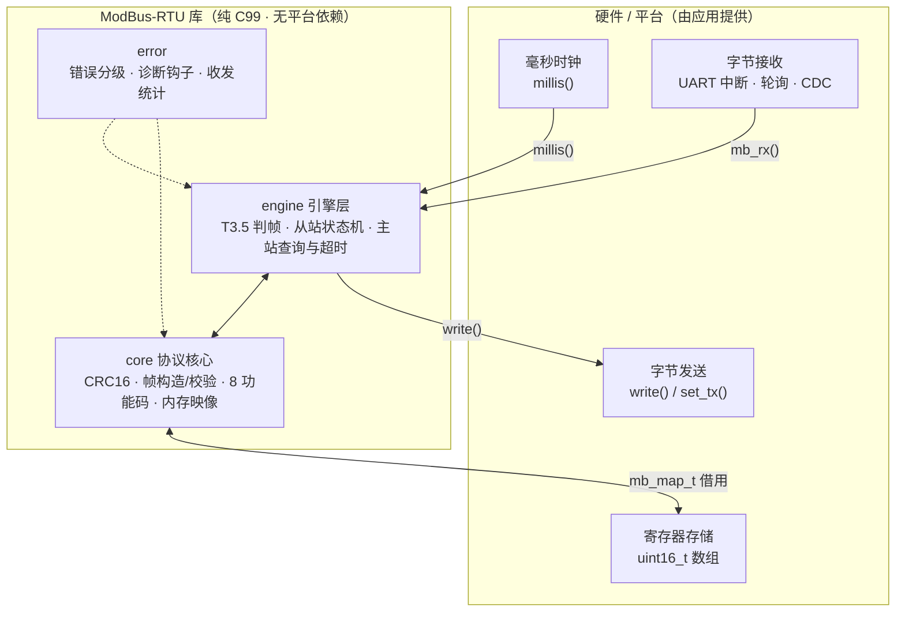

# ModBus-RTU

可移植的 Modbus RTU **主站 + 从站** 协议库。纯 C99，零依赖——不依赖操作系统、RTOS 或任何硬件抽象层，静态分配、无 `malloc`，可直接放进裸机、RTOS（FreeRTOS / Zephyr…）或 Linux 工程。

## 特性

- **主从双角色**：同一个 `mb_t` 实例通过 `cfg.mode` 切换从站 / 主站
- **8 个功能码**：FC1/2/3/4（读）、FC5/6（单点写）、FC15/16（多点写），从站执行与主站发起两侧均完整支持
- **T3.5 静默判帧**：`mb_rx()` 投递字节，`mb_poll()` 检测帧间静默后定帧——不绑定 UART IDLE 中断或 DMA，任何字节投递路径（中断、轮询、USB-CDC 回调）都能接入
- **传输层仅靠回调**：只依赖 `write()`（同步发送）与 `millis()`（单调毫秒时钟）两个回调，`set_tx()` 可选（RS-485 DE/RE 方向控制）；移植即"实现三个函数"
- **协议级错误分级**：协议异常码（回异常帧）/ 链路错误（按规范保持静默）/ 用法错误 / 配置错误，同一枚举 + `mb_err_classify()` 统一分类，并附全局诊断钩子与收发统计
- **无硬件即可联调**：内置内存传输 `mb_memory_t`，PC 上把两个实例对接即可做主从回环自测
- **严格编译**：GCC 下 `-Wall -Wextra -Wpedantic -Werror` 零告警

## 架构



**分层原则**：`core` 层只操作普通缓冲区——不碰时钟、不碰串口、不做动态分配，因此可以脱离任何平台单独做单元测试；`engine` 层负责时序与状态机；与外界的一切交互都收敛在 `mb_cfg_t` 的回调里。

## 目录结构

```
ModBus-RTU/
├── CMakeLists.txt          # 静态库构建，严格告警开关
├── include/modbus/         # 对外 API
│   ├── modbus.h            #   实例 / 配置 / 数据路径 / 主站接口
│   ├── modbus_config.h     #   编译期配置（帧长、T3.5、超时）
│   ├── modbus_error.h      #   错误码、分级与诊断
│   └── modbus_memory.h     #   内存传输（测试 / 仿真用）
└── src/
    ├── core/               # 协议核心：crc / frame / func / map（可独立单测）
    ├── engine/             # 引擎：判帧、从站状态机、主站查询状态机
    ├── error/              # 错误分类与上报
    └── port/               # 内存传输实现
```

## 构建

```bash
cmake -S . -B build
cmake --build build
# 产物：build/libmodbus.a
```

MSVC 下启用 `/W4 /WX`，GCC/Clang 下启用 `-Wall -Wextra -Wpedantic -Werror`；不想把告警当错误可加 `-DMODBUS_WERROR=OFF`。

> **Windows 注意**：若仓库路径含非 ASCII 字符（如中文目录名），`mingw32-make` 会报 `Illegal byte sequence` 而构建失败——把仓库放在纯 ASCII 路径下构建即可（或改用 Ninja / MSVC 生成器）。

### 集成到你的工程

```cmake
add_subdirectory(path/to/ModBus-RTU)
target_link_libraries(your_app PRIVATE modbus)
```

```c
#include <modbus/modbus.h>   /* 或 #include <modbus.h>，两种写法都可用 */
```

不想走 CMake 也可以直接把 `include/` 加进头文件搜索路径、把 `src/` 下的 8 个 `.c` 编进你的目标。

## 快速开始

### 从站

```c
static mb_t    mb;
static mb_map_t map;
static uint16_t holding[10];           /* 保持寄存器存储，由你分配 */

/* --- 由你的移植层实现 --- */
static int      uart_write(void *u, const uint8_t *b, uint16_t n); /* 同步发送 */
static void     uart_set_tx(void *u, bool tx);                     /* RS-485 方向，可为 NULL */
static uint32_t tick_ms(void *u);                                  /* 单调毫秒时钟 */

void slave_init(void)
{
    mb_map_shared(&map, holding, 10);  /* 四个功能码组共享同一数组（经典单内存模型） */

    mb_cfg_t cfg = {
        .mode     = MB_MODE_SLAVE,
        .write    = uart_write,
        .set_tx   = uart_set_tx,
        .millis   = tick_ms,
        .user     = &uart,
        .slave_id = 1,
        .map      = &map,
    };
    mb_init(&mb, &cfg);
}

/* UART 接收路径（中断 / 轮询 / CDC 回调，哪个都行） */
void on_rx_bytes(const uint8_t *data, uint16_t len)
{
    mb_rx(&mb, data, len);
}

/* 主循环，永不阻塞 */
void main_loop(void)
{
    for (;;)
        mb_poll(&mb);      /* T3.5 定帧 → 校验 → 执行功能码 → 回写应答 */
}
```

### 主站

```c
uint16_t values[4];
mb_query_t q = {
    .slave_id = 7,
    .fc       = MB_FC_READ_HOLDING_REGS,
    .addr     = 0,
    .count    = 4,
    .data     = values,     /* 应答数据落这里；结果取走前必须保持有效 */
};

if (mb_master_send(&mb, &q) == MB_OK) {
    for (;;) {
        mb_poll(&mb);                       /* 推进发送 / 收应答 / 超时 */
        mb_err_t err;
        if (mb_master_done(&mb, &err))      /* 结果被本次调用消费 */
            break;                          /* err == MB_OK 时 values[] 已就绪 */
    }
}
```

## API 速览

| 函数 | 说明 |
|---|---|
| `mb_init()` | 校验配置并初始化实例（配置被复制，`map` 为借用） |
| `mb_rx()` | 投递接收到的字节，库内部缓冲至 T3.5 定帧 |
| `mb_poll()` | 驱动判帧、从站状态机、主站查询与超时；非阻塞，主循环调用 |
| `mb_map_shared()` | 把线圈/离散输入/输入寄存器/保持寄存器绑到同一数组 |
| `mb_master_send()` / `mb_master_busy()` / `mb_master_done()` | 主站查询的发起、在途与取结果 |
| `mb_err_classify()` / `mb_err_str()` | 错误分级（异常/链路/用法/配置）与可读描述 |
| `mb_last_error()` / `mb_err_count()` / `mb_in_count()` / `mb_out_count()` | 运行统计，可直接对接日志或上位机诊断 |

### 错误模型

| 类别 | 例子 | 从站行为 |
|---|---|---|
| `MB_CLASS_PROTO_EXC` | 非法功能码 / 越界地址 / 非法数量（异常码 1–4） | 回异常帧（`功能码 \| 0x80`） |
| `MB_CLASS_COMM` | CRC 错、长度错、接收溢出 | **保持静默**，规范要求不回、等主站超时 |
| `MB_CLASS_USAGE` | 从站模式调主站 API、从站 ID 超 1–247 | 由调用方处理返回值 |
| `MB_CLASS_CONFIG` | `mb_init()` 收到不可用配置 | 初始化失败 |

### 编译期配置

在包含库头文件之前定义（或经 `target_compile_definitions` 传入）即可覆盖：

| 宏 | 默认 | 说明 |
|---|---|---|
| `MB_MAX_FRAME` | 256 | 每实例帧缓冲；256 = 规范允许的最大 RTU ADU |
| `MB_T35_MS_DEFAULT` | 5 | 默认 T3.5 静默；≤19200 bps 适用，更高速率规范固定 1.75 ms，可设为 2 |
| `MB_TIMEOUT_MS_DEFAULT` | 1000 | 主站查询默认超时（毫秒） |

`mb_cfg_t::t35_ms` / `timeout_ms` 留 0 即取上表默认值，也可按实例覆盖。

## 并发约束

**一个实例只能在单一上下文中使用。** 若字节来自中断，不要在另一上下文中同时调用 `mb_poll()`——要么让 `mb_poll()` 与 `mb_rx()` 在同一上下文运行，要么在 `mb_poll()` 前后临时关闭接收中断。实例本身静态分配、可内嵌进你自己的结构体。

## 协议边界

- 单帧上限 256 字节（RTU ADU），读写数量上限遵循 Modbus Application Protocol V1.1b3：FC1/2 ≤ 2000 位，FC3/4 ≤ 125 寄存器，FC15 ≤ 1968 位，FC16 ≤ 123 寄存器
- 主站广播（`slave_id = 0`）被拒绝——广播写无应答，无法确认结果；从站侧支持接收广播（写入生效、不应答）
- 在途查询仅一条（半双工 RS-485 的常规用法）；上一结果未被 `mb_master_done()` 取走前不允许发起新查询
- CRC16 采用逐位计算（非查表），换取更小的代码体积，对 115200 bps 场景无压力

## 路线图

- [ ] `tests/`：core 层脱离平台的单元测试（CTest 注册）
- [ ] `examples/`：从站 / 主站示例 + 内存回环演示
- [ ] 演示材料：主从抓包 / 逻辑分析仪波形截图

## 许可

暂未选择开源许可证；如需在项目中引用请先联系作者。
